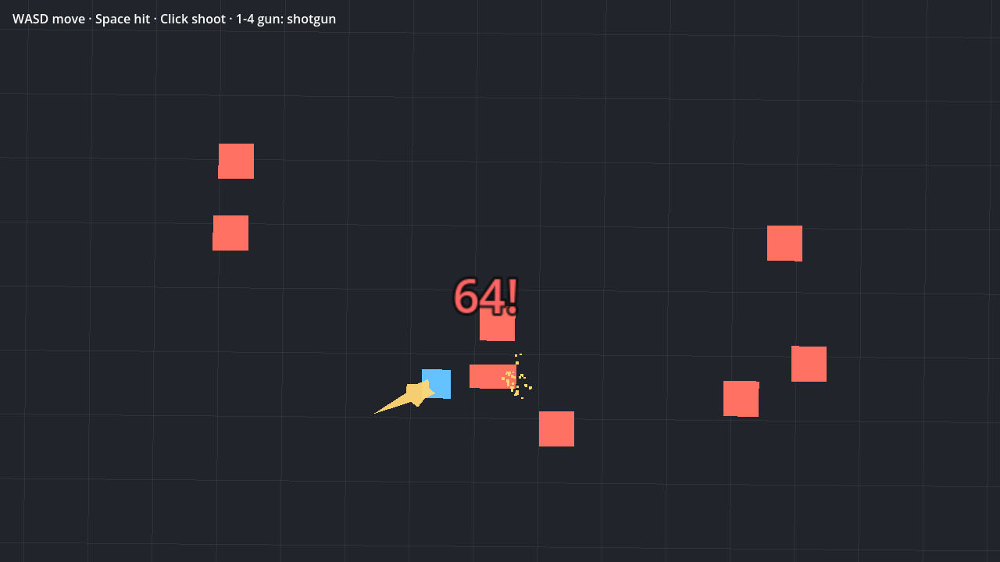

# GameShipKit Game Feel for Godot 4

Make hits feel heavy in your 2D Godot game with one line of code.

Hit stop, screen shake, hit flash, knockback, sparks, damage numbers, gun feel and a smooth 2D follow camera. MIT licensed, no dependencies, Godot 4.2 or newer.



## Install

1. Copy `addons/gameshipkit_game_feel` into your project's `addons` folder.
2. Open Project > Project Settings > Plugins and turn on **GameShipKit Game Feel**.

The plugin adds an autoload called `HitFeel`.

## Use it

Melee hit:

```gdscript
HitFeel.hit($Enemy/Sprite2D, enemy.global_position - global_position, "heavy", 42)
```

`target` is the sprite that flashes and gets pushed. `dir` is the direction of the hit. `tier` is `"light"`, `"heavy"`, `"crit"` or a weapon name. `damage` is the number that pops up (`-1` for none).

Shooting:

```gdscript
HitFeel.shoot($Gun/Muzzle.global_position, aim_direction, "shotgun")   # when the gun fires
HitFeel.hit(enemy_sprite, bullet_direction, "shotgun", 8)              # when the bullet hits
```

Weapons: `"pistol"`, `"smg"`, `"shotgun"`, `"sniper"`. `HitFeel.WEAPONS` also holds fire rate, pellets and spread for your gun code.

If your enemy has `apply_knockback(force: Vector2)`, it is called instead of the visual push.

Smaller pieces you can call on their own: `hit_stop()`, `slow_motion()`, `add_trauma()`, `flash()`, `sparks()`, `shockwave()`, `damage_number()`, `play_sound()`.

## Follow camera

Add a `Camera2D`, attach `follow_camera_2d.gd` (class `GSKFollowCamera2D`) and set `target`. It has a dead zone, smoothing, look ahead, platformer lock, level bounds and pixel snap. `HitFeel` shakes it for you.

## Accessibility

`intensity` (0 to 1) scales all shake. Connect it to a screen shake slider in your options menu. `reduce_flashing` turns off screen flashes and impact frames.

## Tune it in the browser

Every number in `hit_feel.gd` comes from the free [Hit Feel Designer](https://gameshipkit.com/tools/hit-feel-designer/). Try changes on a test dummy, then paste the new constants into the script.

The camera values come from the free [Camera System Builder](https://gameshipkit.com/tools/camera-system-builder/).

## Demo

Open this folder as a Godot project and run `demo/demo.tscn`. Melee and gun hits on test dummies.

## License

MIT. The sounds in `addons/gameshipkit_game_feel/sounds` were made with GameShipKit tools and are under the same license.

Made by [GameShipKit](https://gameshipkit.com/): free browser tools for indie game developers.
